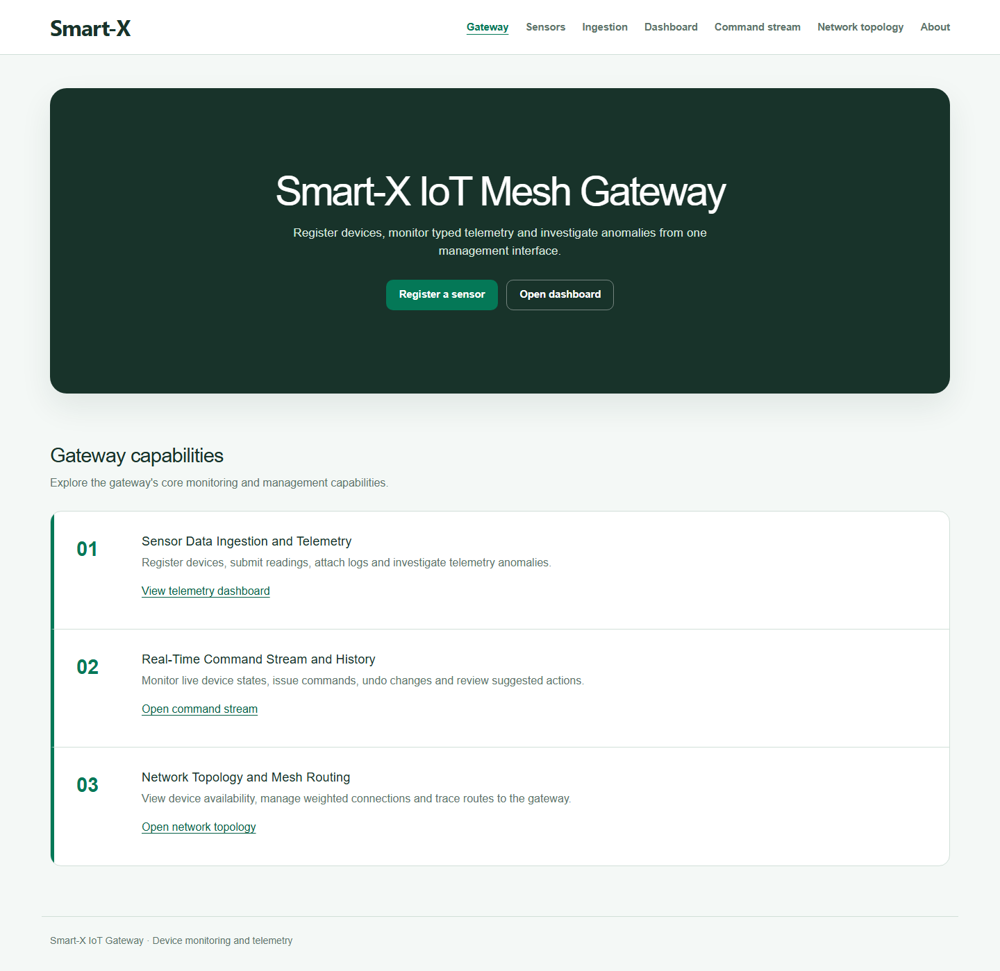
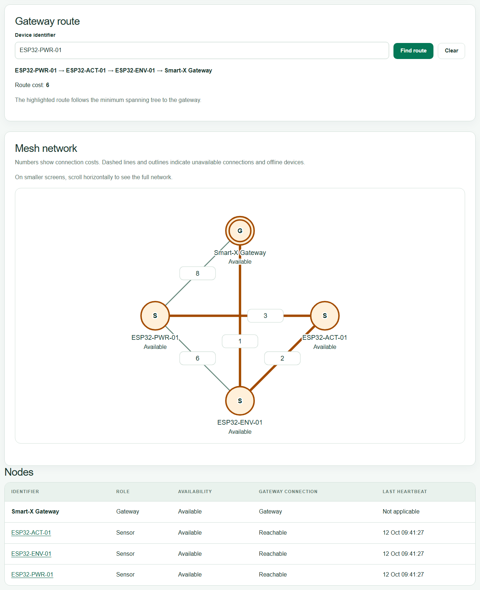
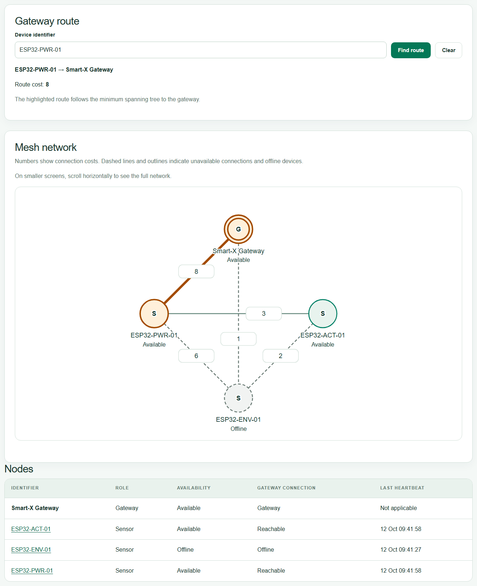
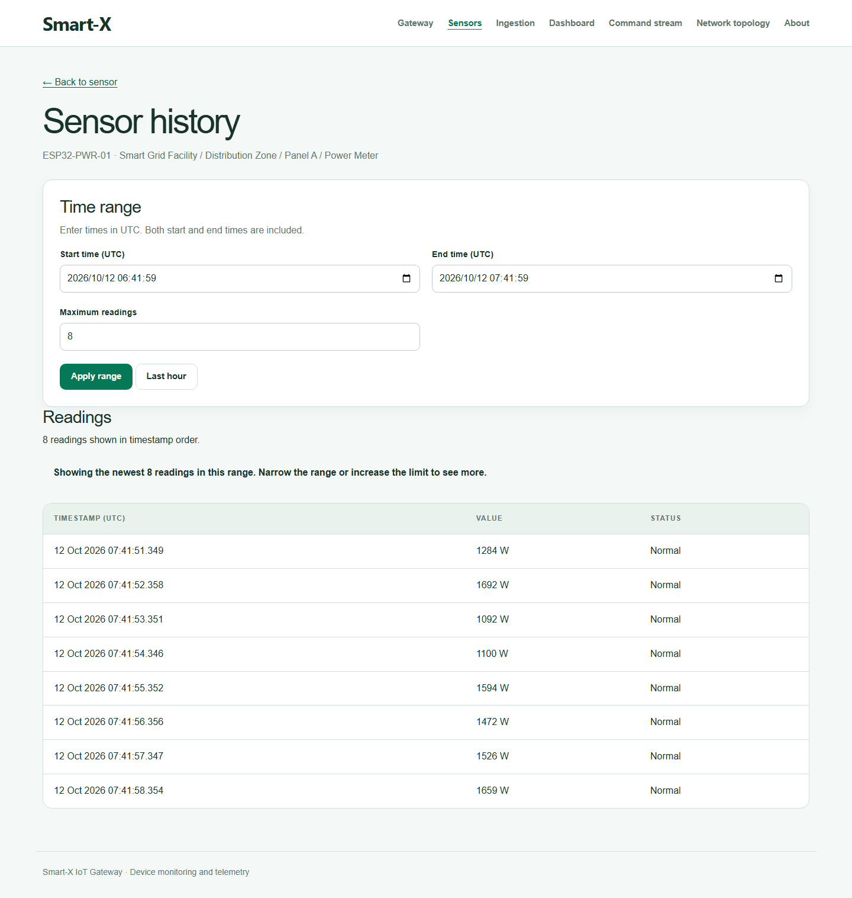
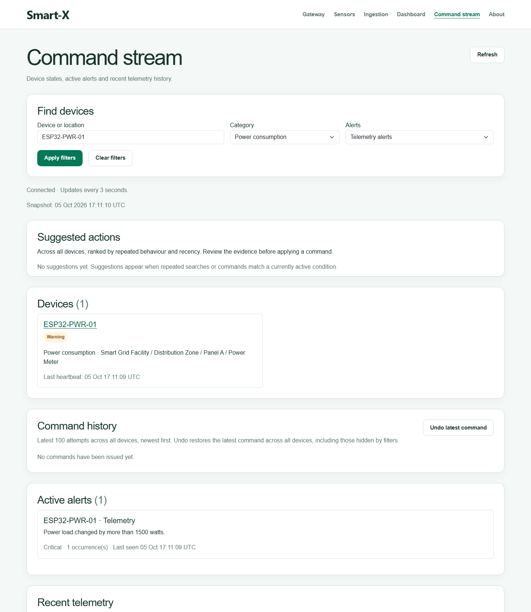
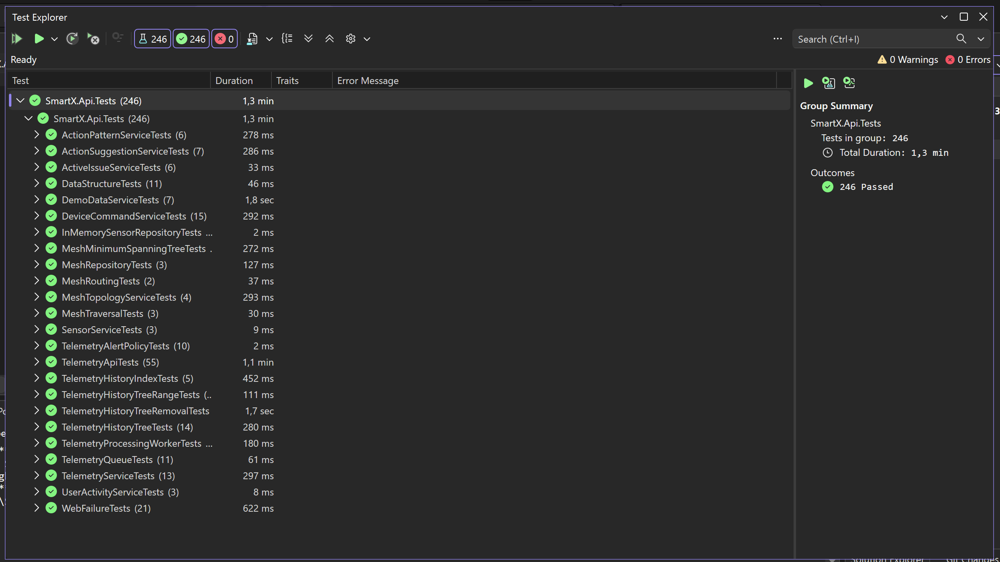

# Smart-X IoT Mesh Ecosystem

A .NET 10 platform for monitoring and managing simulated IoT devices across environments such as hydroponic farms, smart-grid installations and automated properties. An ASP.NET Core Web API ingests and processes telemetry, and an ASP.NET Core MVC frontend provides live dashboards, device control and an interactive view of the mesh network.

The project centres on custom data structures: an AVL tree indexes each sensor's telemetry history, and a weighted graph models the mesh, with breadth-first search for reachability and Prim's algorithm for gateway routing.

Built for PROG7312 at Emeris Durban North (2026).

**Demo video:** [Watch on YouTube](https://youtu.be/pCHtgBJ-BZU)



## Features

- **Telemetry ingestion:** register sensors and submit environmental, power and actuator readings over HTTP. Readings are validated, queued and processed by a background worker.
- **Historical queries:** query a sensor's readings for an inclusive UTC time range, backed by a per-sensor AVL tree, with bounded results returned in chronological order.
- **Mesh topology and routing:** view devices and weighted connections as an SVG network, add, update or remove links, and trace each device's route to the gateway through the minimum spanning tree.
- **Automatic rerouting:** devices that miss their heartbeat are marked offline, and routes are recalculated every few seconds as devices disconnect or recover.
- **Real-time command stream:** search and filter devices, review active alerts and recent telemetry, and send On/Off commands to actuators with stack-based undo and conflict detection.
- **Suggested actions:** repeated searches and commands are learned and ranked into suggestions while the matching condition remains active.
- **Device simulation:** demo devices send readings through the same API as real devices, with adjustable rates and repeatable scenarios such as power spikes and disconnects.
- **Protected attachments:** upload device logs and configuration files, stored encrypted with ASP.NET Core Data Protection and previewed in the browser.

## Tech stack

| Area | Technologies |
| --- | --- |
| Backend | C#, .NET 10, ASP.NET Core Web API, hosted background services, OpenAPI |
| Frontend | ASP.NET Core MVC, Razor, JavaScript, Bootstrap, HTML Canvas charts, SVG |
| Storage | In-memory repositories and collections; encrypted file storage for attachments |
| Testing | xUnit (246 unit and HTTP integration tests) |
| CI | GitHub Actions |

## Architecture

```text
SmartX.Web (MVC)  --HTTP-->  SmartX.Api (Web API)
                               |-- Controllers
                               |-- Services          sensors, telemetry, commands, suggestions, topology
                               |-- Workers           telemetry processing, device simulation
                               |-- DataStructures    AVL history tree, mesh traversal, MST, routing
                               '-- Repositories      in-memory sensor and mesh stores
```

- **API layer:** validates incoming telemetry before queueing it; a hosted worker drains the queue into typed telemetry services.
- **Data structures:** dictionaries for device lookup, queues for pending telemetry, a sorted dictionary for shared history, AVL trees per sensor, a hash set for unique issues, a stack for undo, and an adjacency-list graph for the mesh.
- **Concurrency:** shared mutable collections are synchronised, and a full telemetry queue returns HTTP 503 instead of silently dropping accepted work.
- **Frontend:** a typed `HttpClient` talks to the API, while JavaScript handles live polling, asynchronous navigation and per-tab state.

The [design notes](docs/DESIGN.md) cover the AVL tree, graph representation, BFS, Prim's algorithm and their complexity in more detail.

## Screenshots

| Mesh topology and gateway route | Rerouting after a device goes offline |
| --- | --- |
|  |  |

| Historical telemetry query | Command stream |
| --- | --- |
|  |  |

<details>
<summary>Test results</summary>



</details>

## Getting started

### Prerequisites

- .NET 10 SDK
- No database server or IoT hardware is required

### Run locally

```bash
git clone https://github.com/zenwyn-naicker/smart-x-iot-mesh-ecosystem.git
cd smart-x-iot-mesh-ecosystem
dotnet restore SmartX.slnx
dotnet build SmartX.slnx
```

Start the API and the frontend in separate terminals:

```bash
dotnet run --project SmartX.Api/SmartX.Api.csproj --launch-profile http
```

```bash
dotnet run --project SmartX.Web/SmartX.Web.csproj --launch-profile http
```

Open `http://localhost:5018`. The API runs at `http://localhost:5082`, with a health check at `/health` and the OpenAPI document at `/openapi/v1.json` in Development.

To try the routing features, open **Network topology**, load the sample connections and start the simulation. Pausing a device shows the route recalculating once its 30-second heartbeat window expires.

## Testing

```bash
dotnet test SmartX.slnx
```

The 246 xUnit tests cover the AVL tree and range queries, graph operations, BFS reachability, minimum spanning trees and rerouting, plus the sensor, telemetry and command workflows over HTTP. Some integration tests wait just over 30 seconds to verify disconnect handling. The GitHub Actions workflow restores, builds and tests the solution; it is set to run manually.

## Project structure

```text
SmartX.Api/          ASP.NET Core Web API, services, workers and data structures
SmartX.Web/          ASP.NET Core MVC frontend
SmartX.Api.Tests/    xUnit unit and HTTP integration tests
docs/                Design notes and screenshots
```

All operational data is held in memory and resets when the API restarts. Encrypted attachments and Data Protection keys are written to `SmartX.Api/App_Data/`.

## Acknowledgements

Documentation, libraries and algorithm references used in this project are listed in [CODE_ATTRIBUTION.txt](CODE_ATTRIBUTION.txt).
